# How a place in the novel is put on the map

This is the method the map uses to place each stop of the story, from the words of the book to a point, an area and a published reason. It is written for anyone who wants to check a placement, reuse the method, or write about it. Each step names the code and the decision record behind it.

The method has one aim: **a point is only as precise as the evidence, and every placement says why.** A large, honest area beats a precise, wrong pin (`docs/design.md`, section 6).

## The decision tree

```mermaid
flowchart TD
    A["A stop in the book:<br/>what the text says about where"] --> B{"Does the text name<br/>a place?"}

    B -- "Yes" --> C["Look the name up:<br/>GNIS (US), GeoNames (Mexico), Wikidata<br/><i>crossing.gazetteer</i>"]
    C --> D{"One feature fits<br/>the story?"}
    D -- "Several" --> E["Pick by the story's geography<br/>(distance, direction, order).<br/>Record the others in the reasoning"]
    D -- "One" --> F{"Is the place a point<br/>(town, ranch, spring)?"}
    E --> F
    F -- "Yes" --> G["Stop on the feature<br/><b>located</b>"]
    F -- "No: a range, valley,<br/>draw, plain or river" --> H{"Does the text name a part of it?<br/>head, mouth, pass, rim, floor,<br/>between, foot, slopes, high point"}
    H -- "No" --> I["Stop on the feature's point,<br/>which stands in for all of it<br/><b>approximate</b>"]
    H -- "Yes" --> J["Give the stop a position<br/><i>stop-positions.csv</i>"]

    B -- "No" --> K["Gather the clues: the stops before and after,<br/>direction, time and pace, roads and rivers named,<br/>what can be seen"]
    K --> L["Measure: along a road (TIGER, INEGI),<br/>by distance at a stated pace,<br/>or on the ground (DEM)<br/><i>pipeline/measure/</i>"]
    L --> M["A point and a radius of doubt<br/><b>inferred</b>"]

    J --> N["Tier 1, gazetteer: GNIS source point for a head,<br/>primary point for a mouth, a named gap for a pass.<br/>Tier 1b, for 'between': the divide between two<br/>catchments, aimed at their GNIS heads<br/><i>crossing.positions</i>"]
    N --> O{"Did tier 1 give a point?"}
    O -- "Yes" --> P["Use it<br/><b>inferred</b>"]
    O -- "No" --> Q["Review aids only:<br/>NHD heads, DEM heads, DEM saddles,<br/>nearest ground that fits.<br/>Never published on their own"]
    Q --> R["The owner chooses,<br/>or a reading steered on the DEM<br/>(J1's Animas crossing)"]
    R --> P

    M --> S["Draft the area: the circle of doubt,<br/>cut to the ground the reasoning describes<br/><i>crossing.area_drafts</i>"]
    P --> S
    S --> T{"Is the point inside its area?<br/><i>crossing.validate</i>"}
    T -- "No" --> U["Move the point to the nearest ground<br/>inside, that fits its position<br/><i>points_in_areas.py</i>"]
    U --> S
    T -- "Yes" --> V["Check the ground: geomorphons,<br/>saddle test, height percentile,<br/>over a window sized to the landform<br/><i>crossing.landform_points.check</i>"]
    I --> V
    G --> W
    V --> X{"Flagged?"}
    X -- "No" --> W["Publish: point, area, certainty,<br/>source and reasoning"]
    X -- "Yes" --> Y["The owner reviews on the dev server<br/>(?review=positions):<br/>accept, move to a candidate, or needs work"]
    Y --> W
    W --> Z{"Do two readings<br/>of the text still disagree?"}
    Z -- "Yes" --> AA["Open question on the site:<br/>what is shown, the other reading, and why"]
    Z -- "No" --> AB["Done"]
    AA --> AB
    W -.-> AC["Every judgement call is written up<br/>in docs/decisions/"]
```

## The steps in words

### 1. Read what the text says about where

Each stop starts as a row in `pipeline/seeds/stops.csv`: the episode, the place it names (if any), and a reasoning text that says which clues place it. The novel's words never go into the repository. The reasoning paraphrases them.

### 2. A named place: the gazetteer

`crossing.gazetteer` looks up each named place in GNIS for the United States, GeoNames for Mexico, and Wikidata. Where a name matches several features (three Foster Draws, several Sierras de la Madera), the story's geography picks one: distance from the stops around it, the direction of travel, and the order of events. The others are named in the reasoning, with their distances. Choices that need a person go in `pipeline/seeds/place-overrides.csv`, with a reason.

- **A point feature** (a town, ranch, spring or monument): the stop is on it, **located**, within 250 m.
- **A large feature** (a range, valley or plain) that the text names only in passing: the stop is on the gazetteer's point, which stands in for the whole feature, **approximate**.

### 3. A part of a landform: positions and tiers

The book often puts a stop at one part of a landform: the head of a draw, a pass through a range, the high country between two draws, a rim, a valley floor. The gazetteer's point for the landform is usually elsewhere, such as a stream's mouth or a range's middle. Such stops get a position in `pipeline/seeds/stop-positions.csv`. `crossing.positions` then offers candidates in tiers, most trusted first (decision 0059):

| Tier | What it gives | Trust |
| --- | --- | --- |
| Gazetteer | GNIS's source point (the head) or primary point (the mouth) of a draw, canyon or stream. For a pass, the named gap (GNIS class Gap, GeoNames PASS, GAP or SDL) that adds least to the way between the stops before and after | Published |
| Gazetteer and DEM | For "between" two draws, the drainage divide between their catchments, at its high point nearest the two GNIS heads | Published |
| Vector | The upstream end of the NHD flowline carrying the name | Review aid |
| DEM | A head traced up the main stem, a saddle on the way through a range, or the nearest ground that fits the position | Review aid |

The DEM tiers are review aids because a calibration against 159 GNIS heads found that tracing a stream up from its mouth climbed the wrong branch three times in four (`review/experiments/landform-points/`).

When no tier gives a point, a person decides. One way is to steer the DEM by a reading of the text. For J1's crossing of the Animas Mountains (decision 0056), the owner read the line as going up the east side and over the range halfway. The stop is the saddle where the wolf's least-cost path from that halfway point tops the ridge.

### 4. No name: clues and measurement

An unnamed stop (a camp, a fence, a ford) is placed from its clues: the stops before and after, the direction of travel, the time taken at a stated pace, the roads and rivers the text names, and what the text has a character see. Each measurement is a script under `pipeline/measure/` that names its ellipsoid, projection and sources. Examples are points at a stated distance along a TIGER road (`road_points.py`) and the crossing of a range (`animas_crossing.py`). The result is a point and a radius of doubt, **inferred**.

### 5. The area

An inferred stop is drawn as an area, not a point. `crossing.area_drafts` starts from the circle of doubt around the point, and cuts it to the ground the reasoning describes: a valley floor, a road corridor, or ground that drops to the east (decisions 0020 and 0050). A person can redraw any area by hand (decision 0008). **The point must lie inside its own area.** `crossing.validate` fails a stop whose point does not. `pipeline/measure/points_in_areas.py` moves such a point to the nearest ground inside the area that fits its position.

### 6. The check

Every stop with a position has its ground checked (`crossing.landform_points.check`):

- **Geomorphons** (Jasiewicz and Stepinski 2013) classify the ground into one of ten landforms, at 500 m and 2 km lookouts.
- **A saddle test** looks for two opposite directions higher and the two across them lower.
- **The height percentile** says how high the point stands within its surroundings.

The window grows with the landform: 3 km for a head or pass, 5 km for a rim, foot or slopes, and 8 km for a valley floor. Each position names the ground it expects. A head, for instance, expects a hollow, valley or slope in the upper part of its window. A mismatch is a flag, not an error.

### 7. Review

Flagged stops are reviewed on the dev server (`?review=positions`). The map shows the published point and every candidate, with the review aids marked as such. Each verdict (accept, move to a candidate, or needs work) is saved with the point it was given for, so it goes stale if the stop later moves. `crossing.validate` lists flagged stops without a current verdict. Nothing moves a stop automatically.

### 8. Publish, and say where the doubt is

Every stop is published with its certainty, source and reasoning, and the site names the certainty in plain words: "Named and found", "Roughly here", "Worked out from clues", or "Someone in the book says so". Where two readings of the text still disagree, an **open question** on the site shows what the map follows, the other reading, and why (`data/open-questions.json`). Every judgement call is a decision record in `docs/decisions/`.

## Experimental: testing what a character can see

Some clues are about a view. In episode 2-01, Billy looks east from an escarpment over the Bavispe's barranca to the Carretas Plain. A viewshed tests such a clue: from each candidate lookout, can the named ground be seen at all? For J3's escarpment the answer was almost nowhere. Only two of 617 lookouts see the plain well, 75 km north of the stop, and the clue disagrees with the order of events (`review/experiments/escarpment-view/`). A view test is not part of the method yet. It is a candidate for step 6, as a check on stops whose text describes a view.

## Where to read more

- Decisions: 0008 and 0020 (areas), 0021 (least-cost routes), 0035 (certainty in plain words), 0050 (a stop's area), 0056 (heads and gaps in J1), 0059 (positions, the check and review).
- Experiments: `review/experiments/landform-points/` (the tiers and their calibration), `review/experiments/escarpment-view/` (views), `review/experiments/least-cost/` (routes).
- Notes for writing and talks about this method: `talks/placement/README.md`.
