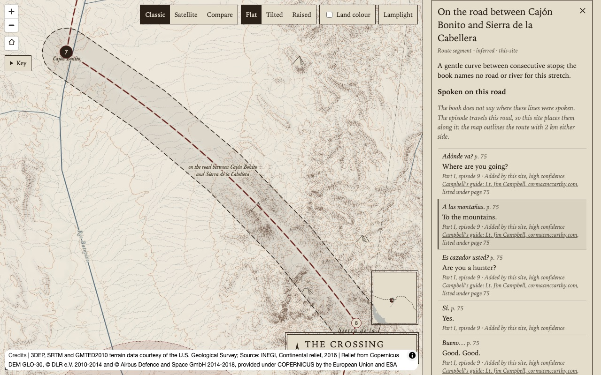
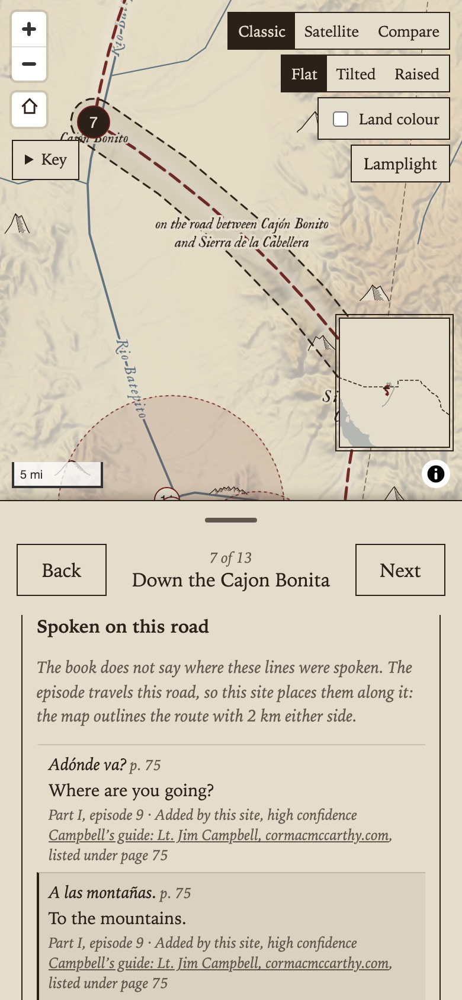
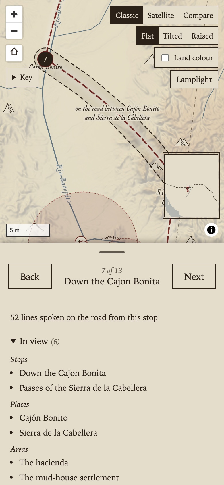
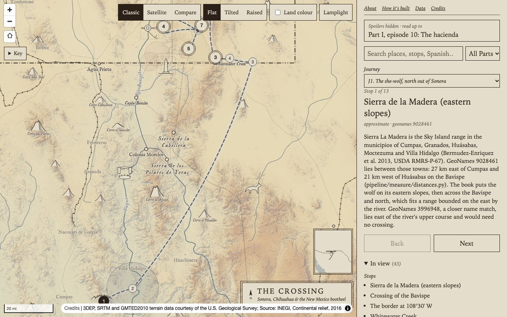
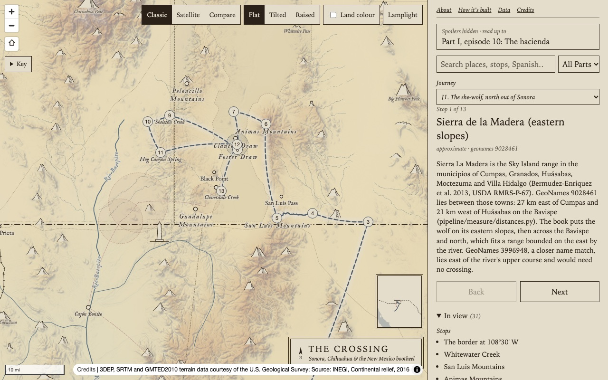

# Stage 5: three map patterns

Three Phase 1 patterns from the plan: talk on the road (section 8), the "In view" list and cluster markers (section 9). Screenshots are in `patterns/`, taken at reading progress "Part I, episode 10".

## Talk on the road

**Data.** Of the 255 lines that had no `location_ref`, 52 now point at a route segment. All 52 are in episode 1-09 (`tr-1-09-003` to `tr-1-09-062`): Billy is on the Cajón Bonita trail south with the wolf, and talks with a man at three ruined houses, a mule train and two women, and five armed riders, before the Cabellera passes. They point at `j2-seg-07` (Cajón Bonito to the Sierra de la Cabellera passes).

The runs are judged by hand and listed in `road-refs.csv` (first line, last line, segment, why, in our own words). The build step applies them only to lines with no place, and stops if a run crosses episodes or its segment is not travelled in the same episode. Every reference now has a `location_kind` (`stop`, `place`, `area` or `road`); `road` marks the inferred ones. `crossing.validate` checks that the kind matches the layer the id is in and that the segment is not first seen after the line. To take a line off the road, write `none` in its `location_ref` cell in `translations-review.csv`.

The other 203 stay null. I left them because they are not spoken while travelling:

| Episode | Lines | Where they are actually said |
| --- | --- | --- |
| 3-09 | 67 | At the blind man's house (stop `j4-blind-man`), mostly the tale told at the table |
| 4-04 | 56 | In a field at the edge of Janos the morning after (stop `j7-janos`, first seen 4-03) |
| 3-07 | 19 | The episode has no stops or segments |
| 1-10 | 17 | At the hacienda (stop `j2-hacienda`) |
| 3-01 | 10 | At the ejido where the opera company camps (stop `j4-opera-camp`) |
| 3-11, 3-12 | 12 | At San Diego (3-11 has no stops) |
| Others | 22 | Single glosses, and short exchanges at a house or by a fire (2-02, 3-10, 4-07; 4-07 has no segments) |

The 3-09, 4-04, 1-10 and 3-01 lines could take the stop named in the table. That is a stop reference, not a road one, so it was not done here (see the questions below).

**App.** Picking a line placed on the road (in search, or from a stop) opens the segment's card, titled "On the road between Cajón Bonito and Sierra de la Cabellera", with a short note on how the lines were placed and every line spoken on that road. The map frames the segment, outlines it buffered 2 km (dashed edge, faint fill) and labels the corridor "on the road between X and Y". X and Y are the names of the places at the segment's two ends, or the stop names where a stop is not at a named place. The buffer is worked out in the browser (`site/src/map/corridor.ts`): offset curves 2 km each side, round at the ends and outside each bend. For `j2-seg-07` every outline point is 1,997 to 2,002 m from the drawn route. A stop whose road out has such lines shows "52 lines spoken on the road from this stop", which opens the same card.

## In view

A collapsible "In view" section in the panel lists what the map shows now: the stops of the journey in focus, then places and areas, each sorted by name. It reads the same spoiler-filtered data the map draws, and it updates 250 ms after the map stops moving. Each entry opens its stop (as the stop list does) or its card. Context towns, which the book never names, are left out. An area counts as in view when its bounding box overlaps the view. Each group shows 12 entries, with "Show all". The section is open at first on a desktop. In the phone drawer it starts closed and sits under the stop card.

## Cluster markers

Only in a box around Cloverdale and the Peloncillos (108.70° to 109.25° W, 31.30° to 31.72° N): the Guadalupe and Peloncillo ranges, the Animas Valley and the SK Bar, where J1, J2, J3 and J7 all pass. In the box, the places and the focused journey's stops share one clustered source, clustered up to zoom 8 with a 40 px radius. Each cluster is a marker with its count, a double ring, in the tab order. A click or Enter zooms to where it opens, and zooming in opens it too. From zoom 9 everything shows. The current stop is never clustered, and stepping flies to zoom 9 or closer, so Back and Next always show the stop. With J1 framed (zoom 8), the box's 22 places and stops make 5 clusters.

## Checks

`tsc -b`, `oxlint`, `npm run build`, `crossing.validate` and `crossing.downloads --check` pass. The spoiler-leak test passes at 1-08, 4-05 and a first visit, in both themes. It now also opens "In view" in full, opens the road card of each stop that has one, and reads the clustered and corridor sources.

## Questions for the owner

1. The 150 null lines that are clearly at one stop (3-09 blind man's house, 4-04 Janos, 1-10 hacienda, 3-01 opera camp) could get those stops by hand in `translations-review.csv`. Should I fill them in?
2. Should clicking a route on the map also open its segment card? Now only a line or the stop link opens it.
3. The cluster box is a rectangle chosen by eye. Is it the right extent, or should it grow with more Part IV stops near the SK Bar?
