# Stage 6: the "by lamplight" theme

This packet covers the dark theme in the plan's section 5.1 ("A dark 'by lamplight' theme keeps the same lines on a near-black paper") and the lamplight sprite in section 5.2 (layer 2, step 4). The light theme is unchanged: its colours moved into a palette, with the same values.

## What was built

| File | What it is |
| --- | --- |
| `site/src/map/tokens.ts` | Two palettes, `light` and `lamplight`, each with the paper, ink, water, journeys, the S5 relief colours (Imhof tint, plain paper above zoom 10, hillshade, hachures, contours) and the Raised view's streams |
| `site/src/map/style.ts`, `relief.ts` | `literaryStyle(..., theme)`, `reliefLayers(palette)` and `raisedLayers(classic, palette)` build every layer in either palette, with the theme's sprite |
| `site/src/map/StoryLayers.tsx`, `LayerKey.tsx` | The journeys, places, areas and the key take a `theme` |
| `site/src/theme.ts` | `useTheme()`: follows `prefers-color-scheme`; a choice that differs from the system is kept in `localStorage` (`crossing-map.theme`) |
| `site/src/map/MapView.tsx` | The Lamplight toggle among the map switches, and the repaint on a switch |
| `site/src/index.css` | Lamplight values for `--paper`, `--ink`, `--ink-faint`, and two new variables (`--alert`, `--veil`) for colours that were hard-coded; MapLibre's controls; Land colour by lamplight; the switches wrap on phones |
| `art/build_sprite.py`, `site/public/sprites/glyphs-lamplight*` | A second sheet with the drawings' ink and paper swapped for the lamplight colours |
| `tools/lamplight-sheet.mjs` | The checks and screenshots below |
| `tools/contrast.mjs` | The contrast ratios below |
| `tools/spoiler-leak.mjs` | `COLOR_SCHEME=dark` runs the leak test by lamplight |

Rebuild the sprites: `uv run --project pipeline python art/build_sprite.py`. Retake the screenshots, with the site served on port 5190: `cd tools && node lamplight-sheet.mjs`.

## How switching works

- **Default.** The theme follows the system's colour scheme. `theme.ts` sets `data-theme` on `<html>` when it is first imported, before the first render, and follows changes of the system setting while no choice is stored.
- **The toggle.** "Lamplight", after Land colour, a pressed button when on. A choice that differs from the system is stored; a choice that matches it removes the stored value, so the theme follows the system again.
- **The map.** The style is built once. A switch calls `setPaintProperty` for every layer from the same style built in the other palette (the base, relief and raised layers), and `setSprite` for the glyphs and vignettes. The story layers get the new palette through their props. Nothing touches the camera, the layers' visibility (Flat, Tilted, Raised) or their filters (spoiler mode), and the sources are not reloaded.
- **Satellite and Compare** keep the light theme's inks for the journeys and places over the imagery, and the Compare underlay is the light map. Only the controls, panel and pages follow the theme. Switching to Satellite repaints the hidden base in light; switching back repaints it by lamplight.
- **Land colour** by lamplight inverts the light theme's trick: the imagery is darkened over black and the map is screened over it, not multiplied. MapTiler refuses localhost, so this is **not tested** (see the questions).

### Checks (`node lamplight-sheet.mjs --checks`, all pass)

A dark system scheme gives lamplight and a light one gives light; the toggle switches theme and keeps the camera; the choice survives a reload; a choice matching the system is not stored. In the Raised view at zoom 12.5 with progress at 1-08: the camera and view stay, the raised layers stay shown and the flat relief hidden, the raised strokes take the lamplight sepia, the story labels and the journeys' halo are repainted, every layer's filter and the story data are identical before and after, and the sprite is the lamplight sheet.

Also passing: `npx tsc -b`, `npx oxlint`, `npm run build`, `crossing.validate`, and the spoiler-leak subset (`SPOILER_POINTS=1-08,unset`) in both themes (`COLOR_SCHEME=dark` for lamplight). No console errors in any run: Flat and Raised in both themes, Tilted and a 390 px phone by lamplight.

## Screenshots

Around the Sierra de los Pilares de Teras (zoom 7 is centred further east to show the border). Progress set to "Finished".

| | Light | Lamplight |
| --- | --- | --- |
| Zoom 7, Flat: the Imhof tint | 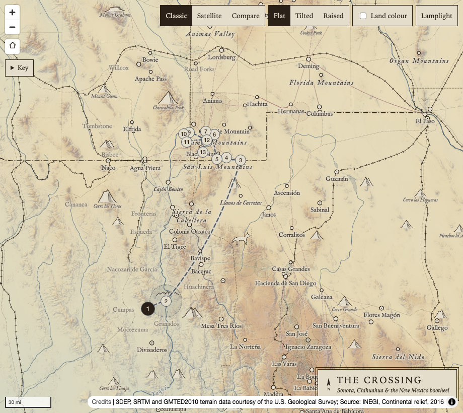 | 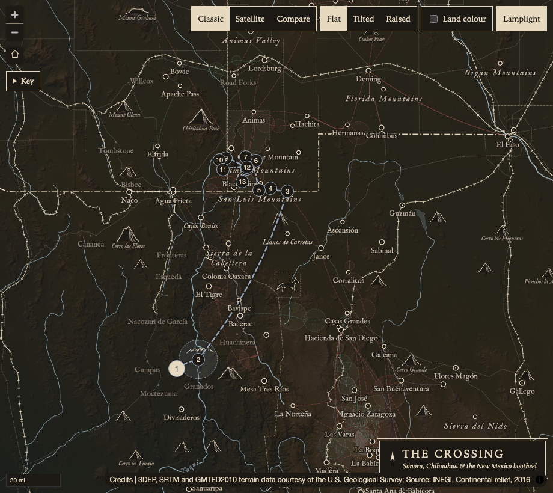 |
| Zoom 10, Flat: the fade to plain paper, the line work starts | 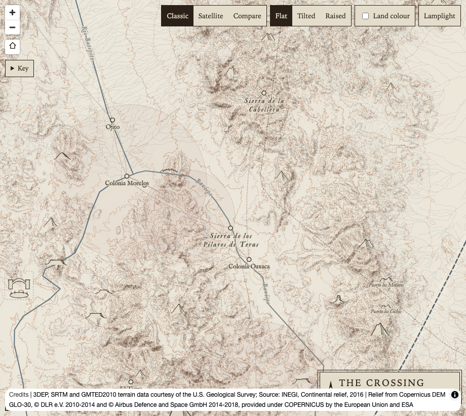 | 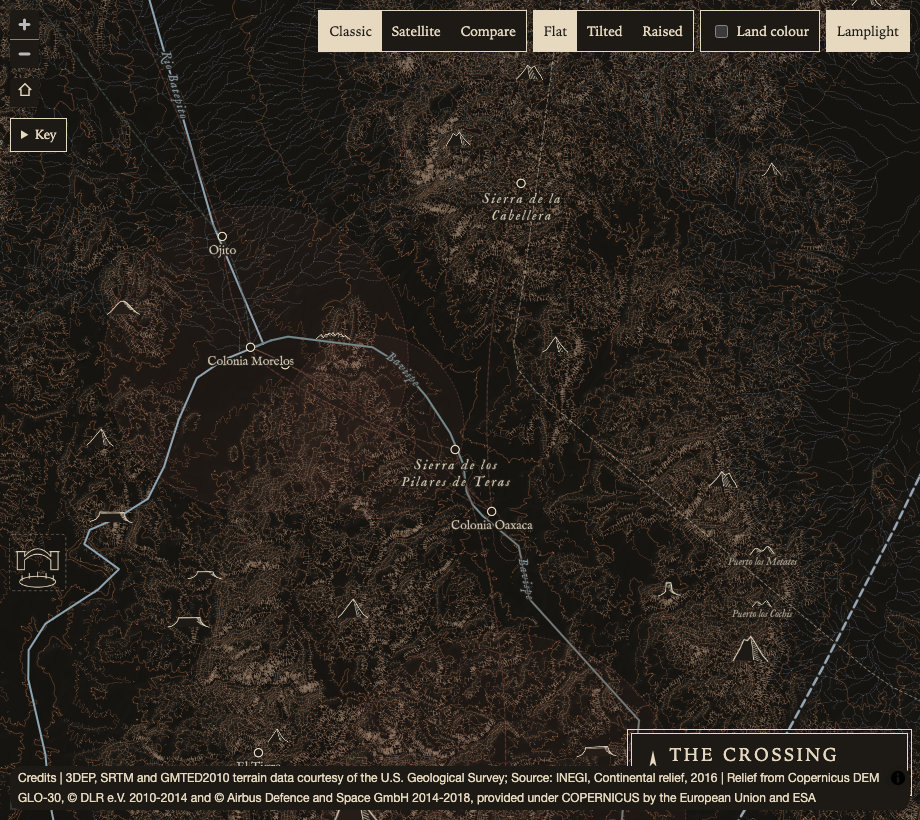 |
| Zoom 12.5, Flat: dense hachures and contours | 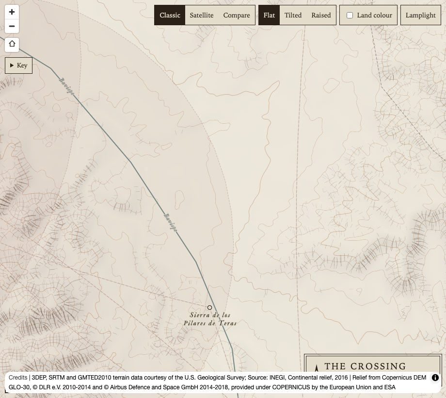 | 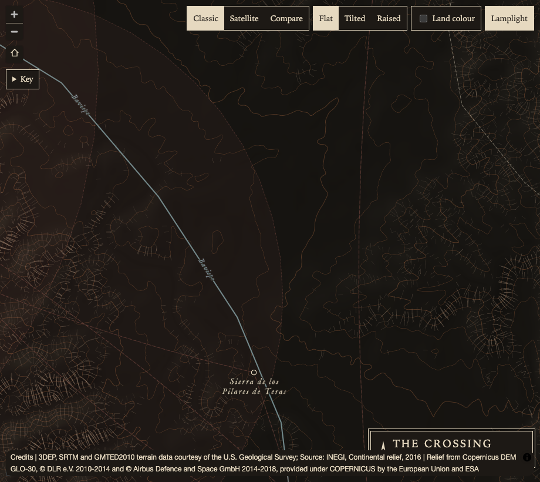 |
| Zoom 12.5, Raised | 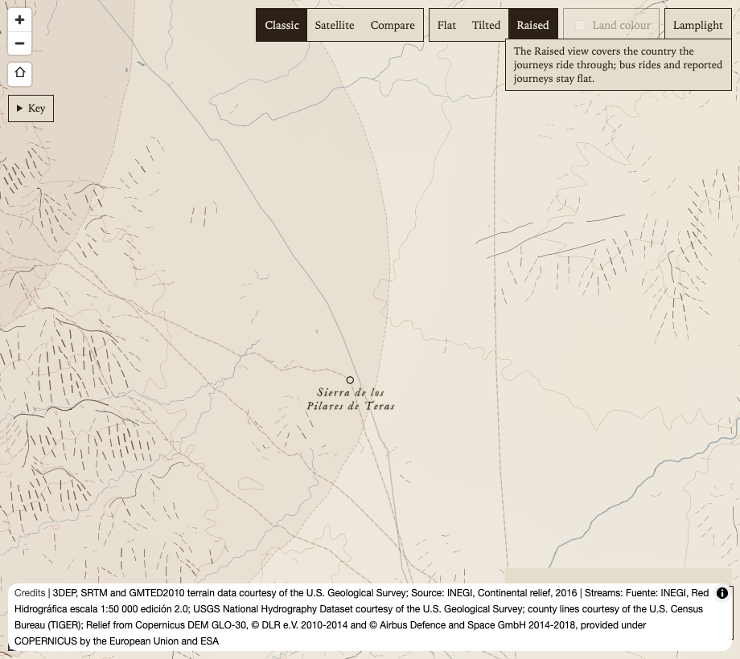 | 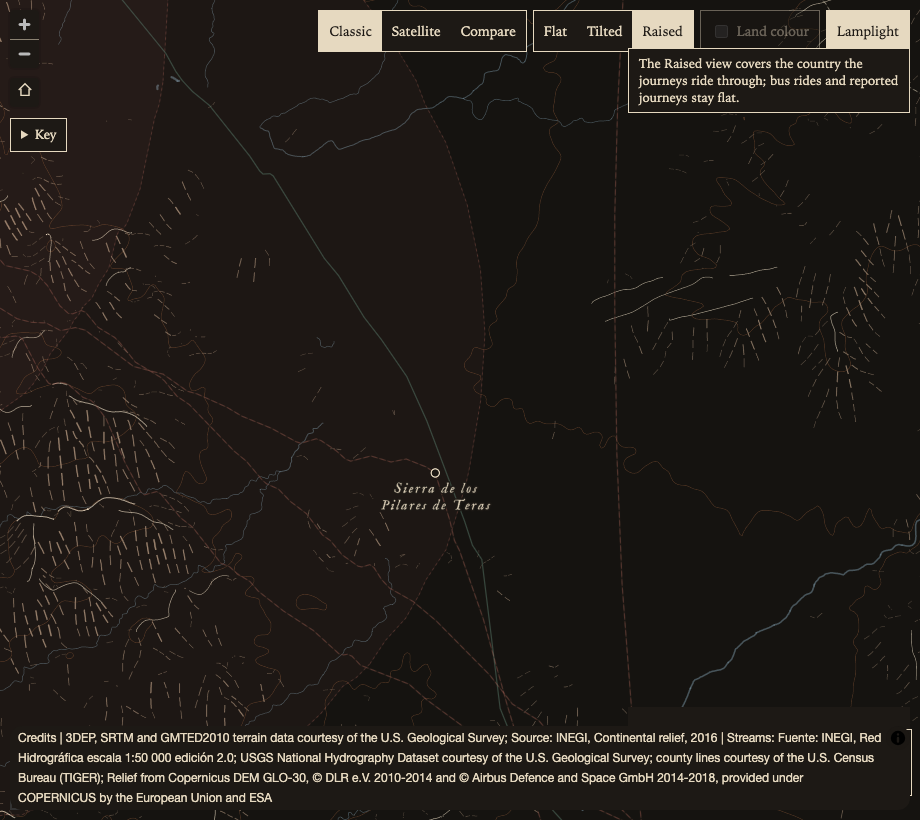 |
| The panel and the key (zoom 9) | 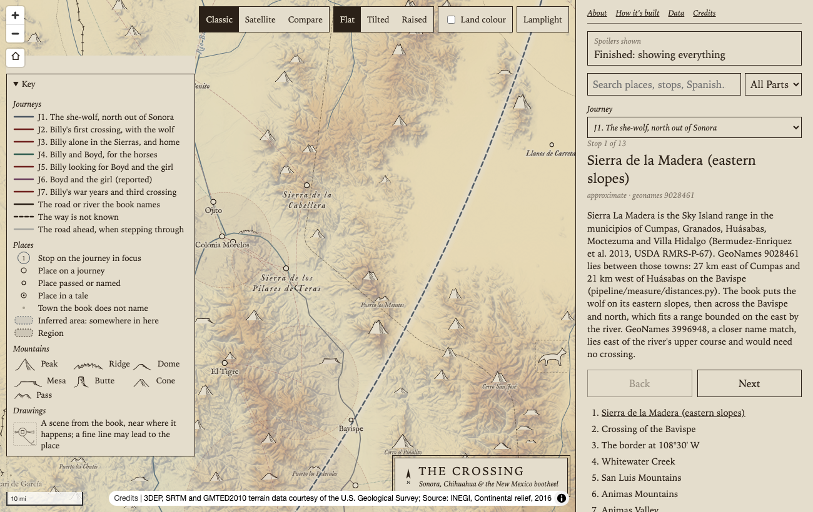 | 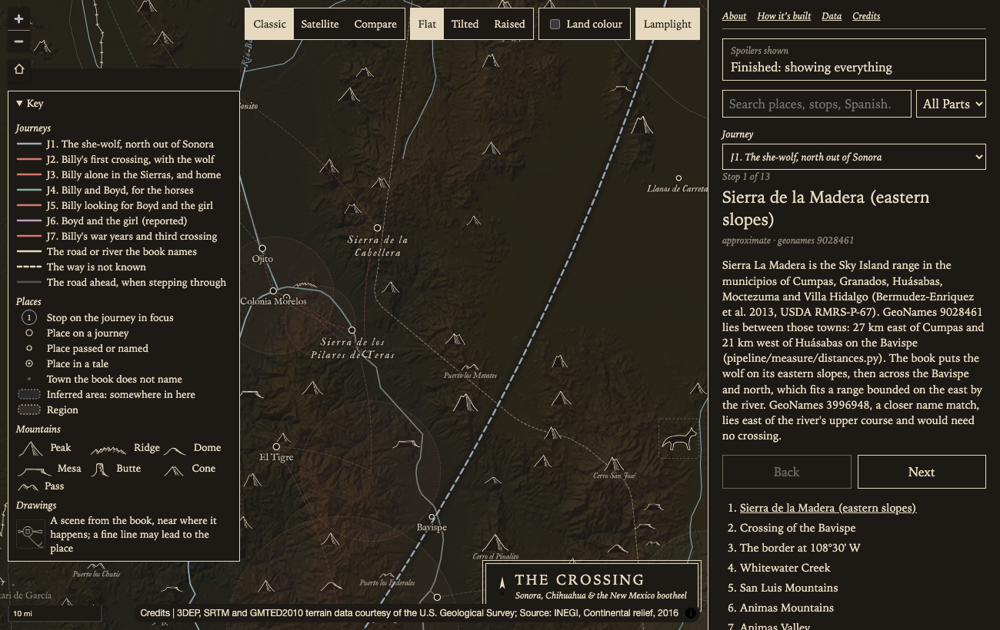 |
| A page (About) | 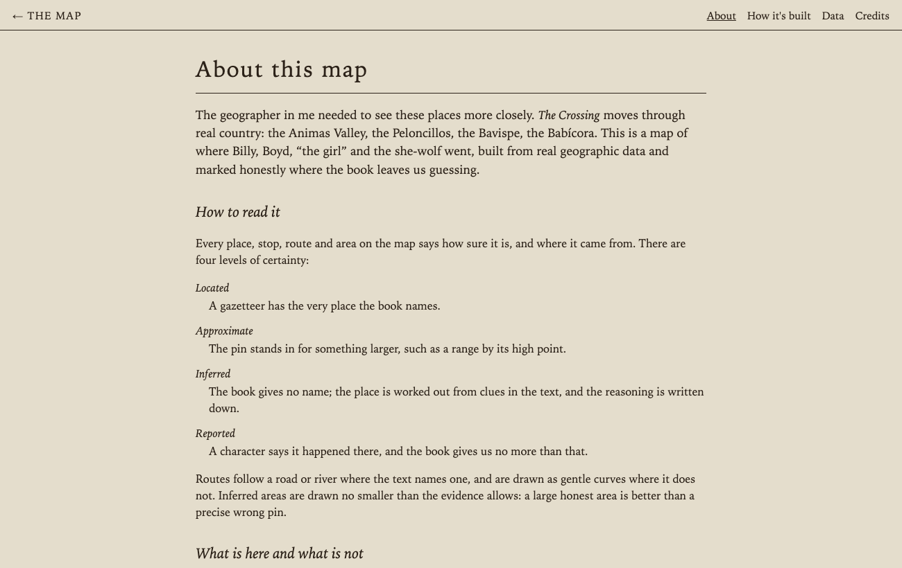 | 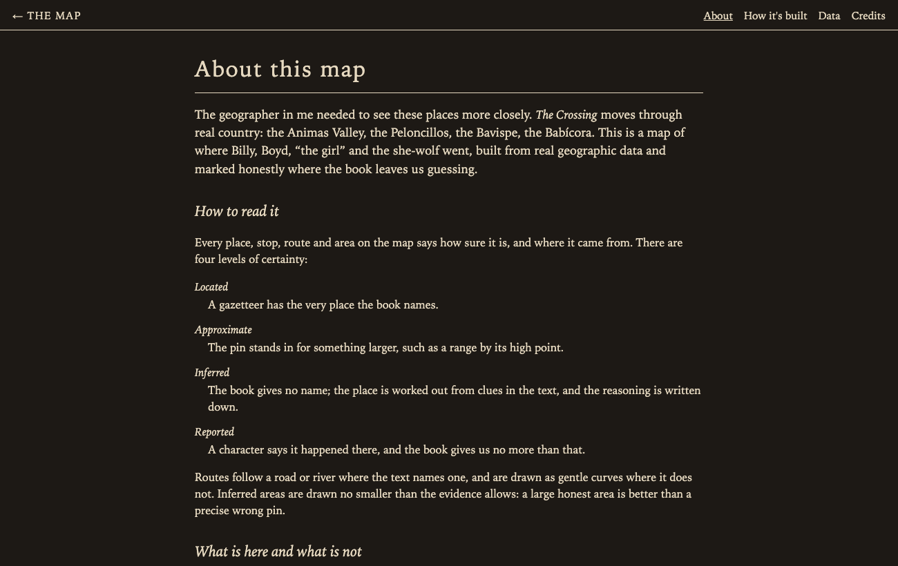 |

## The palette

| Token | Light | Lamplight | Note |
| --- | --- | --- | --- |
| paper | `#e4ddcc` | `#1d1915` | Near-black, warm |
| paperMexico | `#d9cfbb` | `#16130f` | A shade darker in both |
| paperShown (above zoom 10) | `#f1ede2` | `#171512` | Plainer than the paper in both: lighter by day, deeper by lamplight |
| ink | `#2b2118` | `#e6d9c0` | Warm light ink |
| water | `#5f7480` | `#8ea6b3` | |
| wolf, Billy, Boyd, the girl | `#4a5560`, `#6e1f1c`, `#2f5d50`, `#6a3d5c` | `#9cadbd`, `#d97a6c`, `#7fb8a2`, `#c99bc0` | Same hues, lightened |
| hachures | `#6e5443` | `#9a846f` | See below |
| contours | `#b0622e` | `#a9683f` | |
| Imhof tint (0 to 3,200 m) | grey-green to ochre to pale | `#1b201c` to umber `#3a2d1f` to `#3f3b36` | Same order: hazy basins, warmer sierra, lighter summits |
| hillshade, below zoom 10 | blue-violet shadow, warm light | blue-black shadow, faint warm lamplight | |
| hillshade, from zoom 10 | light grey | black shadow at 45%, warm light at 12% | |

Light lines on dark paper read stronger than dark lines on light paper at the same contrast. A first try with the hachures at 7:1 against the paper (the light theme's are 6:1) made zoom 10 look busy, so the lamplight hachures, contours and raised streams sit a little under their light-theme contrast (hachures 5.1:1, contours 4.1:1 against 3.9:1, raised streams 4.3:1 against 3.2:1), to keep the relief behind the story.

## Contrast (WCAG 2, `tools/contrast.mjs`)

Text needs 4.5:1 (AA, normal size); the journeys' lines are graphics and need 3:1. Semi-transparent colours are composited over the paper first. Map labels also carry a paper halo, so over the Imhof tint they keep the ratio against paper.

| Pair | Light | Lamplight |
| --- | --- | --- |
| Ink on paper | 11.63 | 12.52 |
| Ink on the Mexico side | 10.19 | 13.27 |
| Ink on the paper above zoom 10 | 13.46 | 13.06 |
| Panel faint text (`--ink-faint`, ink at 55%) | **3.32, fails** | 4.64 |
| Context town labels (ink at 60%) | **3.80, fails** | 5.27 |
| Summit labels (ink at 80%), above zoom 10 | 7.44 | 8.67 |
| River labels on paper | **3.61, fails** | 6.87 |
| River labels on the Mexico side | **3.16, fails** | 7.28 |
| Creek labels above zoom 10 | **4.18, fails** | 7.16 |
| To-do notes (`--alert`) | 6.35 | 7.02 |
| Pressed switch (paper on ink) | 11.63 | 12.52 |
| Journeys (3:1): wolf, Billy, Boyd, the girl | 6.51, 9.57, 6.41, 7.37 | 7.92, 6.03, 8.05, 7.75 |

Every lamplight pair passes. Five light-theme pairs fail AA; they are older than this work and unchanged (see the questions).

## Decisions made without you (conservative calls)

1. **Satellite and Compare keep the light inks** for the story layers, and Compare's classic half stays light. "Unaffected except for UI chrome" read literally.
2. **A choice that matches the system is not stored**, so a reader who toggles back returns to following the system. There is no third "system" state in the toggle.
3. **Light theme colours unchanged**, including the five pairs that fail AA.
4. **The relief by lamplight is a little quieter** than a straight contrast match (above).
5. **The inferred areas and story fills keep their light-theme opacities** (12% in focus). By lamplight the areas read a little stronger; changing that would mean per-theme opacities.
6. **The map switches wrap on phones.** At 390 px wide they already ran off the left edge before this work; the new toggle made it worse, so the row now wraps, clear of the zoom buttons, onto up to three lines. The panel rework may replace this.
7. **The lamplight sprite is made by swapping two colours** in each SVG. The script stops if a drawing lacks either colour, so a hand-drawn set must use the same ink and paper hexes, or the script needs a palette per drawing.

## Questions for the owner

1. Is the lamplight paper dark enough, or too dark? It is `#1d1915`, a warm near-black; `#262019` would be a softer brown-black.
2. Should Satellite and Compare also take lamplight inks over the imagery (light inks would stand out more on dark imagery)?
3. Land colour by lamplight is untested here (MapTiler refuses localhost). Please look at it on the deployed site and keep it, tune it, or turn Land colour off by lamplight.
4. Fix the light theme's five AA failures? The water at `#465a65` (4.67:1 on the Mexico side) and `--ink-faint` and the context labels at ink 70% (5.04:1) would pass, at some cost to the faded look.
5. Should the toggle offer "follow the system" as a third state, rather than the implicit reset in decision 2?
6. The toggle's label is "Lamplight" with no icon. A lamp glyph would save width on phones.
