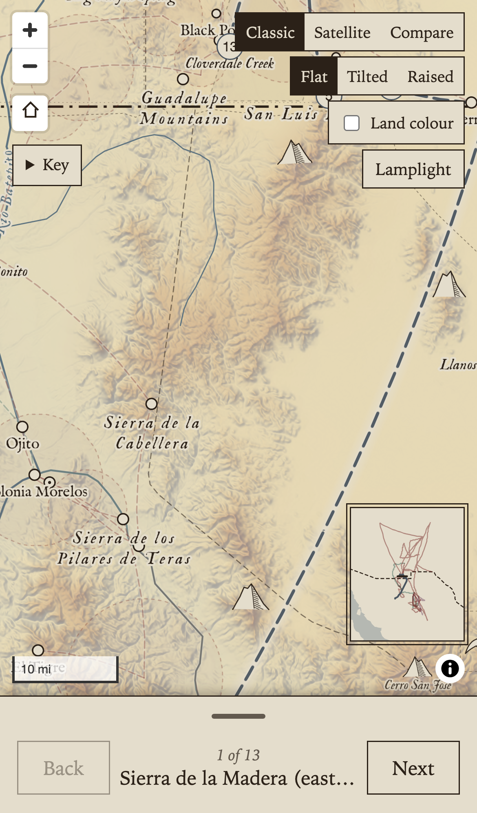
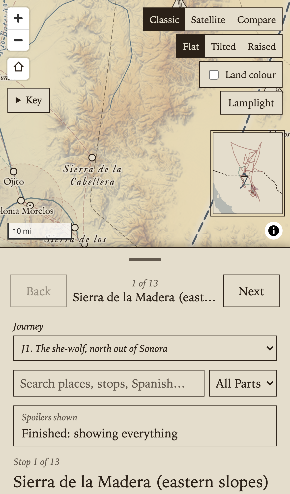
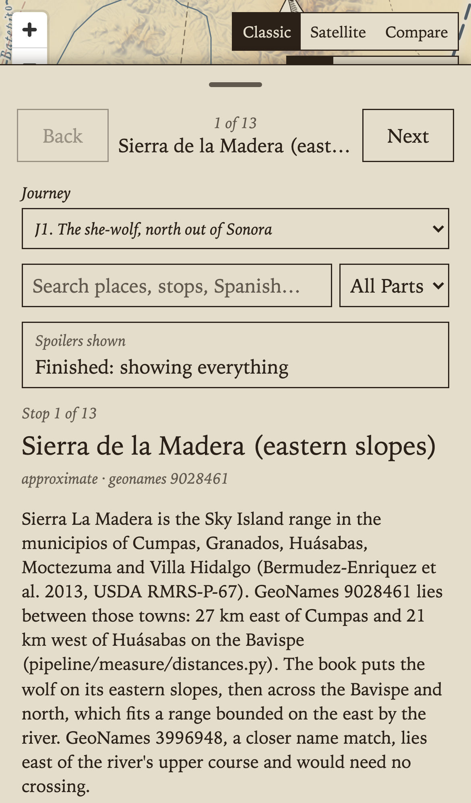
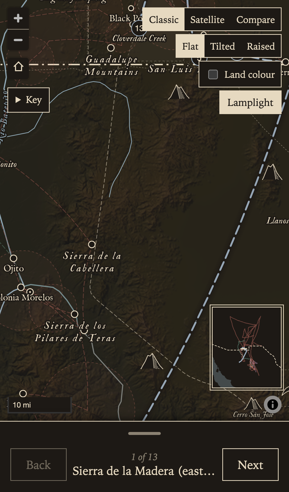
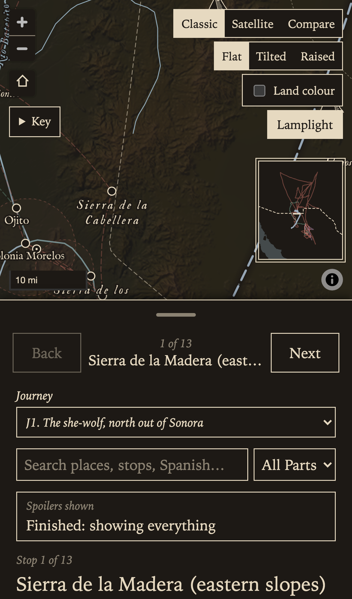
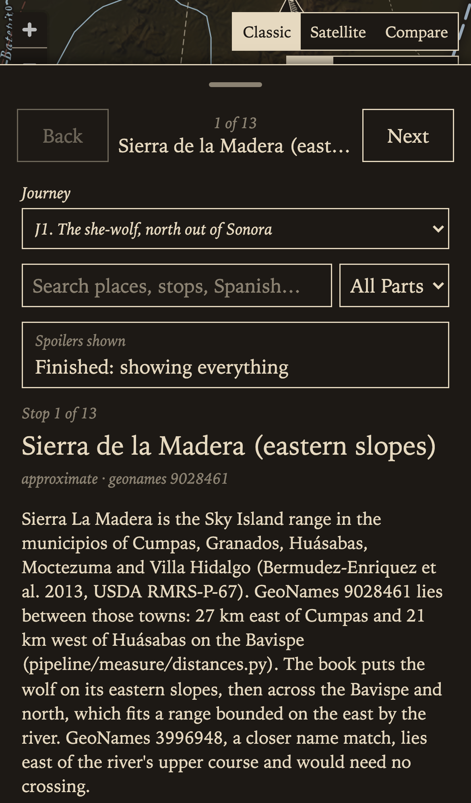
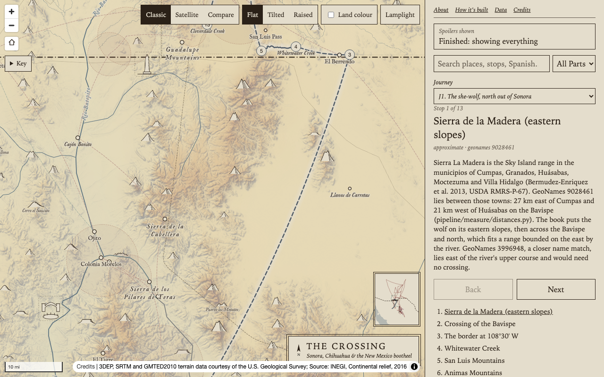

# Stage 5 and 6 review: the interface shell

> **Since this packet (13 November 2026).** The lamplight theme and the "In view" list have been removed; the screenshots that show them are out of date.

This packet covers the phone drawer, the overview inset, and the accessibility and performance passes (plan sections 9, 11 and 12). Screenshots are an iPhone 14 viewport (390 x 844) in Playwright, with reading progress set to the end of the book.

## Phone drawer

Below 720 px wide the panel becomes a bottom sheet (`site/src/panel/Drawer.tsx`). It has three heights: peek (96 px over the safe-area inset), half (50%) and full (92%). The handle drags (it snaps to the nearest height, or to the next height after a flick), and a tap raises it one step (from full it goes back to peek). With the keyboard, Enter or Space works like a tap, the up and down arrows raise and lower it one step, and Home and End go to peek and full.

The panel's content is the same as on desktop, in a different order. The stepper (Back, the stop, Next) is in the peek row. The journey picker, the search box and the reading-progress badge come next, so at half height a thumb reaches them all in the lower half of the screen. The page links are at the end.

The map stops at the drawer's top at peek and half height, so its zoom buttons, scale and credits stay clear of the drawer. At full height the map keeps its half-height size, behind the drawer. A pick on the map or in search raises the drawer to half height so its card shows. Focus on the search box opens it to full height, so the results show above the phone's keyboard. Keyboard focus that moves below the peek row raises a lowered drawer to half. With reduced motion the drawer moves without animation. On phones the map switches stack down the right edge, and the compact credits start closed behind their (i) button.

| Peek | Half | Full |
| --- | --- | --- |
|  |  |  |
|  |  |  |

## Overview inset

When the view spans less than half the story box, a 92 px inset of the whole region shows (`site/src/map/OverviewInset.tsx`). It has the land, the sea and the international border, the journeys reached so far (the journey in focus is darker), and a box for the view. In the Tilted view the box is the view's footprint on the ground. The Raised view has no inset, because its line work is shifted north and would not sit under the box. The land and the border are from Natural Earth 1:10m, clipped and simplified with GDAL. The inset uses the colours of the current theme. Off-map arrows are not built (see the questions below).

## Accessibility

A keyboard-only walk with Playwright at desktop and phone sizes (34 checks):

| Control | Result |
| --- | --- |
| Reading-progress dialog | Opens on the first visit, holds focus, slider by arrow keys, Enter and Escape close it, and focus goes back to the badge (fixed: it was lost while the modal dialog made the badge inert) |
| Map | Takes focus; the arrow keys pan and plus and minus zoom. Its name says so ("Map. Arrow keys pan, plus and minus zoom") |
| Zoom, Home, credits | MapLibre buttons with names; the credits toggle is now "Show or hide the map credits" |
| Basemap and view switches | Fixed: each group is one tab stop, and the arrow keys move the choice (the radio group pattern) |
| Land colour, Lamplight | Native checkbox and toggle button |
| Compare swipe | Slider, left and right arrows. Not testable on localhost, because MapTiler refuses localhost and the map goes back to Classic. It passed once before that happened |
| Key | Native details and summary |
| Search | Typing, ArrowDown into the results, Enter opens the card, the card's close button |
| Stepper and stop list | Buttons; Next by Enter |
| Pages | The heading takes focus; Tab stays on the page (the map under it is inert); the back link returns |
| Drawer handle | Button with expanded state and a name with its height; keys as above |
| Stop markers | Fixed: out of the tab order (up to 57 tab stops on J7 before the map's controls). The panel's stop list reaches the same stops |

Focus: one ring everywhere, 2 px in the theme's ink. On the map it is drawn inside the map's box. Before this, most controls had the browser's blue ring.

Contrast (WCAG AA, 4.5:1 for small text): ink on paper is 11.6:1. The faint ink (`--ink-faint`, used for the italic notes, stop counts and Part labels) was 3.3:1 in the light theme. It is now 0.7 opacity, 5.0:1. In Lamplight it is 4.6:1 and was not changed. The search box's placeholder was the browser's grey at 3.4:1; it now uses the faint ink.

Screen readers: the main view has a hidden `h1`, the inset is an image with a name, the cartouche is hidden, and the Spanish has `lang="es"`. Nothing was tested with VoiceOver or NVDA. Only the names and roles were read from the DOM.

Not fixed:

- At full height the drawer's handle is at the top of the screen, out of a thumb's reach. Picks lower the drawer to half by themselves, but a swipe down on the content does not move the sheet.
- Hover names on the map (MapTip) have no keyboard equivalent. The stop list and search cover the stops and places.
- The text on the map canvas (labels with halos) was not measured for contrast.

## Performance

Bundle by chunk (`npm run build`, minified, gzip in brackets). MapTiler and the pages stay lazy:

| Chunk | Size | Loaded |
| --- | --- | --- |
| `index` | 1,439 kB (406 kB) | First load. maplibre-gl 1,035 kB, react-dom 208 kB, the app 52 kB, minisearch 18 kB, pmtiles 14 kB |
| `maplibre-gl-worker` | 520 kB | First load |
| `index.css` | 86 kB (14 kB) | First load |
| `SatelliteMap` | 1,301 kB (346 kB) | First use of satellite, compare or land colour. Almost all is `@maptiler/sdk`, which bundles its own copy of MapLibre |
| `Pages` | 71 kB (24 kB) | First page opened |

Search is not lazy: minisearch is 18 kB (about 6 kB gzipped), too small to be worth a separate chunk.

First load (`tools/first-load.mjs`, median of 3 runs, a first visit served gzipped as GitHub Pages does). The phone run uses Lighthouse's mobile throttling (150 ms round trip, 1.6 Mbit/s, CPU slowed 4 times):

| | Map ready (MapLibre `load`) | Map drawn (opening tiles in, idle) | Requests | Transferred |
| --- | --- | --- | --- | --- |
| Phone, throttled | 12.2 s | 14.6 s | 34 | 1,755 kB |
| Desktop, unthrottled | 1.3 s | 1.6 s | 78 | 4,939 kB |

What the opening view fetches:

| | Phone | Desktop |
| --- | --- | --- |
| terrain.pmtiles (hillshade and tint) | 10 requests, 765 kB | 52 requests, 4,051 kB |
| Script | 402 kB | 402 kB |
| Sprites (the @2x sheet on the phone) | 252 kB | 143 kB |
| Story data (7 files) | 161 kB | 161 kB |
| Glyphs | 73 kB | 73 kB |
| base.pmtiles | 34 kB | 41 kB |
| relief, relief-dense, contours (headers only) | 54 kB | 54 kB |

The script that counts the requests does not see the worker script (about 150 kB gzipped), because a worker's requests do not reach the page's network log.

Findings:

- The hillshade's terrain tiles are most of the first load: about 78 kB per 256 px Terrarium PNG, and 52 tiles on a desktop. They are in `relief.ts` and the tile pipeline, which this work did not touch. Two possible changes: lossless WebP encoding, or 512 px tiles requested at one zoom lower. Either would need a check that the relief looks the same.
- The relief-dense and contours archives each load their header at zoom 6, where their layers do not show. That costs 36 kB, and the sources would need to be added on demand in the style.
- I tried a cheap win: jumping, not flying, to the first journey. It did not change the request count, because the whole-region tiles are requested before the story data arrives. I reverted it.
- On a throttled phone, about 12 s of the 14.6 s is before MapLibre's load event: the script, the sprite sheet and the first terrain tiles all compete for 1.6 Mbit/s.

## Questions for the owner

1. The drawer opens at half height on the first load, so the reading-progress badge and search show. Should it open at peek instead, with more map showing?
2. Off-map arrows for far places were not built. Which places count as "far": the next stop when it is off screen, or every place named in the current episode?
3. Should someone take on the terrain tile size (WebP or 512 px) with the relief work?
