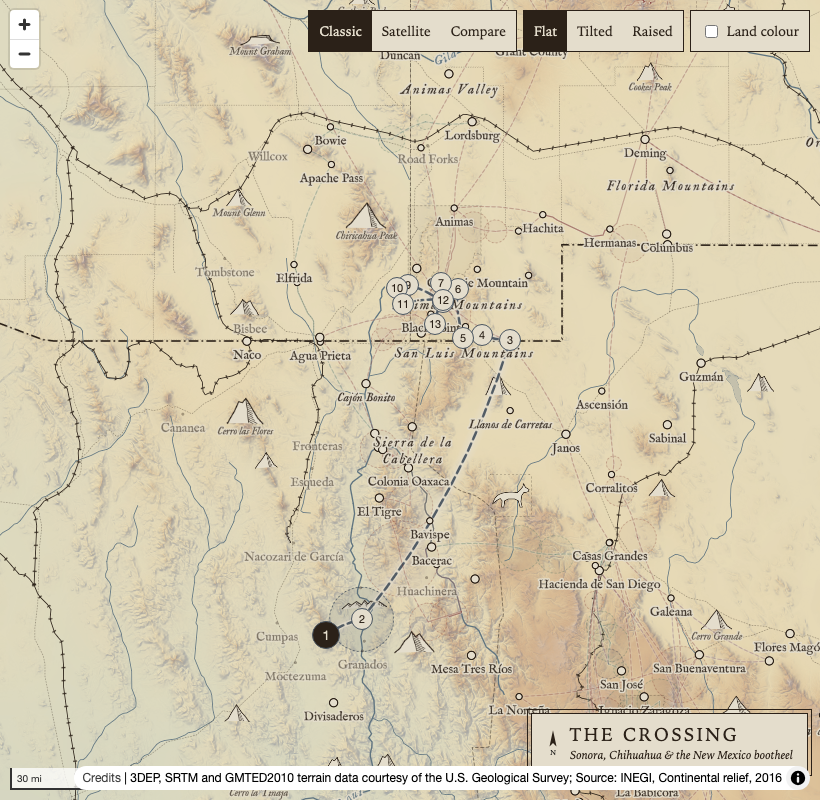
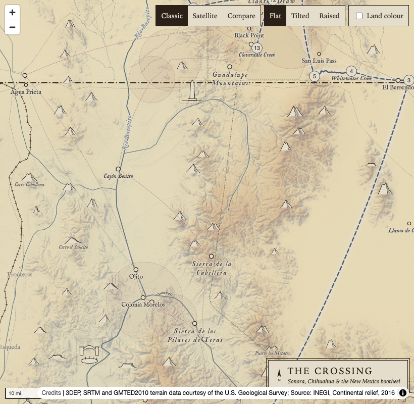
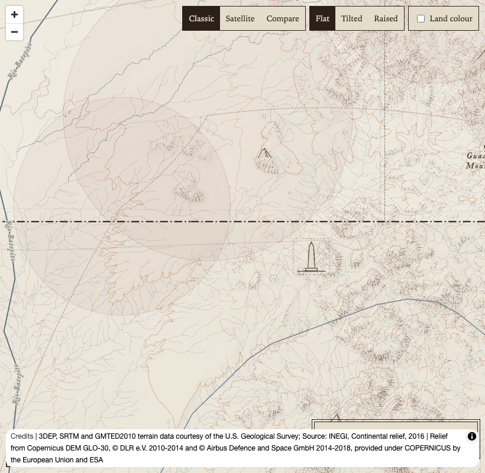
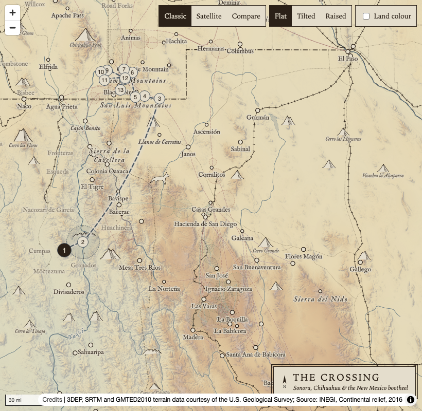
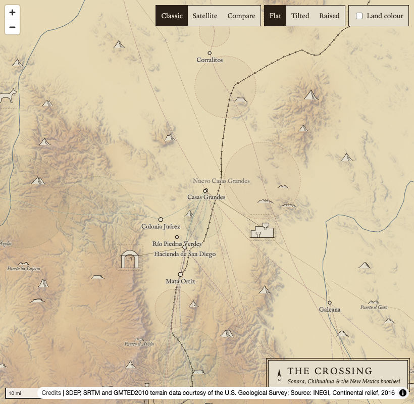
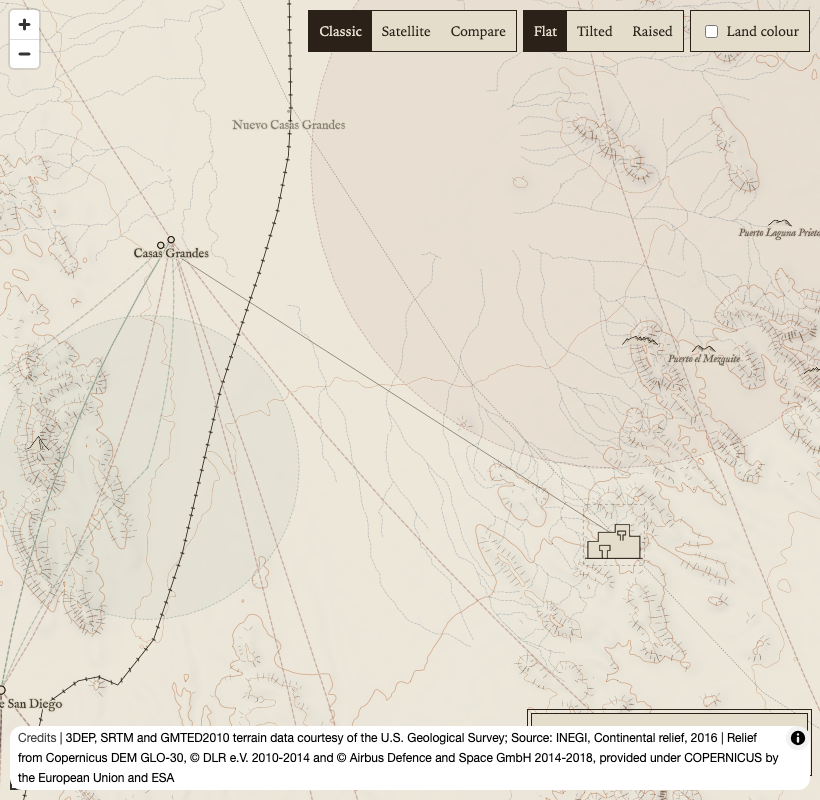
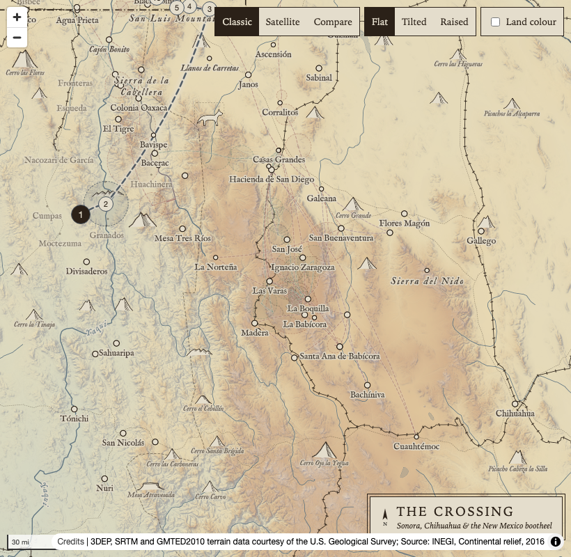
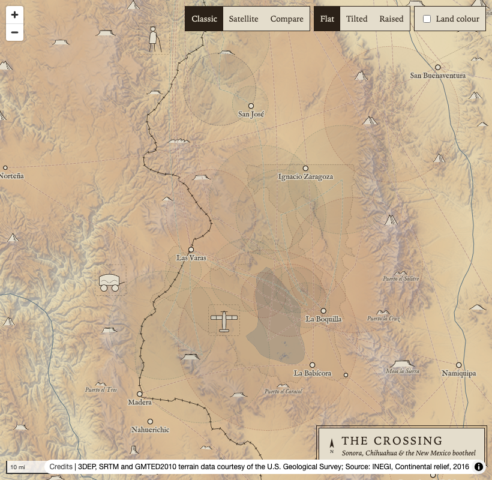
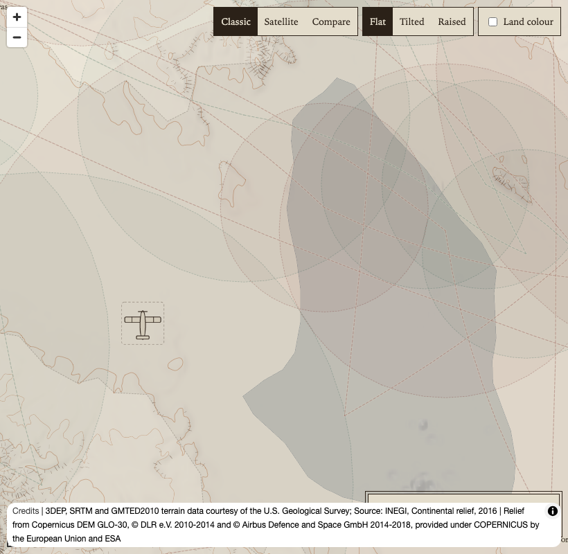

# Stage 6: the first twelve vignettes (placement only)

This packet is for checking where the vignettes go, not what they look like. It covers the plan's section 10: twelve of the candidate drawings, their anchors, and the map layer that draws them.

**The drawings are placeholders.** Each one is a plain silhouette in the map's ink and paper, inside a dashed frame that marks it as provisional, on the plan's 96 by 96 grid. They exist only so that the anchors, sizes and collisions can be judged on the map. The real drawings will be the owner's or an illustrator's (plan section 10; Phase 2 adds more by an illustrator). A real drawing replaces `art/vignettes/svg/vignette-<id>.svg` under the same name, and `art/build_sprite.py` rebuilds the sprite.

## What was built

| File | What it is |
| --- | --- |
| `pipeline/seeds/vignettes.csv` | The twelve picks: what each stands for, the stop or place it refers to (`ref`), the anchor, a leader flag, zoom range, priority, `first_seen`, a one-sentence paraphrased note, and the reasoning for the anchor |
| `pipeline/src/crossing/build_vignettes.py` | Writes `data/vignettes.geojson`. It adds to each anchor's reasoning its distance and bearing from what it stands for and from the nearest stop or place (pyproj, WGS 84), and stops if an anchor is closer than 8 km to any stop or place |
| `data/vignettes.geojson` | 12 points (`kind: vignette`) and 2 leaders (`kind: vignette-leader`, LineStrings) |
| `data/schema/story-layer.schema.json` | New properties `stands_for`, `min_zoom`, `max_zoom`, `priority`; `vignette` is the drawing's sprite name |
| `art/vignettes/make_vignettes.py`, `art/vignettes/svg/` | The placeholder drawings |
| `art/build_sprite.py` | Packs the mountain glyphs and the vignettes into the one sprite with spreet (the glyphs are unchanged) |
| `site/src/map/relief.ts`, `style.ts` | The `vignette` symbol layer and the `vignette-leader` line layer, between the mountain glyphs and the labels |
| `tools/vignette-sheet.mjs` | Takes the screenshots below and checks the layer's visibility and the console |

Rebuild: `uv run --project pipeline python -m crossing.build_vignettes`, then `uv run --project pipeline python art/vignettes/make_vignettes.py`.

## The twelve, and why

I picked the candidates a reader would know from one glance at a small drawing, spread across the book: four from Part I, two from Part II, three from Part III and three from Part IV. Each is a single object or creature that the book shows clearly, at a place the data already holds.

Distances are from `data/vignettes.geojson` (pyproj, WGS 84). "From its site" is from the stop or place in `ref`.

| Vignette | Part | First seen | Stands for | From its site | Nearest stop or place | Zooms | Priority |
| --- | --- | --- | --- | --- | --- | --- | --- |
| The she-wolf, walking north | I | 1-04 | J1, the wolf's journey | 102 km at 50° from the Bavispe crossing | Eastern escarpment rim, 28 km | 6 to 11 | 1 |
| A steel trap with the drag | I | 1-03 | The trapline in the Peloncillos | 11 km at 281° from Hog Canyon Springs | Starvation Canyon, 10 km | 8 to 12 | 2 |
| The boundary obelisk | I | 1-09 | The monuments along 31°20′ N | 11 km at 105° from "a monument in sight" | Volcanic-plain ranch, 10 km | 8 to 13 | 2 |
| The hacienda gate and the dog pit | I | 1-10 | The hacienda near Morelos | 20 km at 227° from the hacienda | El Tigre, 19 km | 8 to 12 | 2 |
| The ruined church | II | 2-01 | The church at Huisiachepic | 16 km at 76° from Huisiachepic | Las Ramadas, 16 km | 8 to 12 | 1 |
| Paquimé's mud walls | II | 2-08 | The ruins of Paquimé (leader) | 18 km at 122° from Paquimé | J7 stop east of Casas Grandes, 12 km | 8 to 12 | 2 |
| The San Diego gate, L. T. | III | 3-01 | The Hacienda de San Diego (leader) | 15 km at 260° from the hacienda | Colonia Juárez, 13 km | 8 to 12 | 1 |
| The opera caravan with its gilt | III | 3-01 | The troupe stranded on the Madera road | 16 km at 263° from the camp | River camps, 15 km | 8 to 12 | 2 |
| The blind man with his cane | III | 3-09 | The blind man's house | 15 km at 270° from the house | Desert crossroads, 14 km | 8 to 12 | 2 |
| The red Waco plane | IV | 4-04 | The red plane over the lake country | 15 km at 253° from the lake camp | Wagon-road crossing, 9 km | 8 to 12 | 3 |
| The gypsies' wrecked airplane | IV | 4-06 | The gypsies on the river trail | 17 km at 71° from their camp | The same camp, 17 km | 8 to 12 | 1 |
| The crippled dog | IV | 4-08 | The ruined waystation | 16 km at 114° from the waystation | The same waystation, 16 km | 7 to 12 | 1 |

The reasoning for each anchor is in the seed and in each feature's `reasoning`. The rule throughout: put the drawing in empty country beside the thing, on the side away from the other stops and labels.

Candidates left out of this batch: Keno, because the episodes where he appears (2-07, 2-08) do not call him one-eyed, so the plan's drawing would need checking first; the antelope, Bird, the Mormon storehouse, the ox cart and the Babícora Hereford, because a small drawing of each is easy to mistake for another animal or building; La Purísima at Caborca, the blind man's Parral road and the false dawn, because they need an inset or an off-map arrow; the locomotive and the cranes, kept for the next batch so that the Las Varas and Babícora country is not crowded; the yellow bus and the guitar, which are hard to draw legibly at this size.

## How the layer behaves

- **Where it sits.** The leaders and the drawings draw above the mountain glyphs and below every label. The story labels (places-label) are placed first, so a label always wins an overlap and the drawing hides.
- **How many show.** Each drawing shows only between its `min_zoom` and `max_zoom`. At zoom 7 only the she-wolf and the crippled dog can show; from zoom 8 all twelve can. Symbol collision then places `priority` 1 first, then 2, then 3. In the shots below, 0 to 3 drawings show in each view. The drawing is about 43 px across at zoom 7, 53 px at 9 and 67 px from 12.
- **Leaders.** Only Paquimé and the Hacienda de San Diego, the two real, located sites, get a hairline leader. The hacienda of Part I, Huisiachepic and the camps are inferred, so a leader to them would claim a precision the data does not have.
- **Basemaps and views.** Both layers are in `BASE_LAYERS`, so they hide over satellite imagery, the same way as the mountain glyphs; in Compare mode they show only in the classic half. Both are in `NOT_RAISED` (one line in `MapView.tsx`), so the Raised view hides them. The Tilted view keeps them. The screenshot script found both layers hidden in Raised and shown again in Flat. MapTiler refuses localhost, so satellite fell back to the classic map in the test; the satellite check rests on the same `BASE_LAYERS` mechanism the glyphs use.
- **Not done here.** The spoiler filter by `first_seen` and a key toggle belong to the spoiler-mode work in `App.tsx` and `Panel.tsx`. The layers come from the style, not from `StoryLayers.tsx`, so that work can call `map.setFilter` on `vignette` and `vignette-leader`, adding `['<=', ['get', 'first_seen'], progress]` to the existing filter. Episode ids are zero-padded, so string order is reading order.

## Screenshots

Classic map, Flat view, J1 in focus, 1200 by 800 browser (the map area is 820 px wide). Zoom 11 is centred between a drawing and what it stands for.

| Area | Zoom 7 | Zoom 9 | Zoom 11 |
| --- | --- | --- | --- |
| Part I border country |  |  |  |
| Casas Grandes |  |  |  |
| Babícora and Las Varas |  |  |  |

What they show: at zoom 7, the she-wolf on the Llanos de Carretas (in the Part I view) and the crippled dog, which the query finds but which sits under the map controls at the top right; at zoom 9, the hacienda pit and the obelisk in Part I, Paquimé and the San Diego gate with their leaders at Casas Grandes, and the blind man, the opera caravan and the red plane around Las Varas; at zoom 11, the obelisk, Paquimé (with a long leader) and the red plane.

## Questions for the owner

1. **The she-wolf.** The plan anchors her in the Peloncillos or the Animas Valley. That corridor is the most crowded part of the map, so she stands instead beside the empty leg of her route out of Sonora, about 25 km east of it. Is that the right image, or do you want her in the Animas country with a smaller drawing?
2. **The obelisk.** The book's first obelisk is the one Billy sees east of his crossing in 1-09, not one at 108°30′ W, so the drawing is there, just south of the line. Should it point to a real monument (the boundary commission's monument list would give one), with a leader?
3. **Long leaders.** At zoom 11 and over, a leader is about 280 px long. Should drawings with leaders stop at zoom 11, or move closer to their sites at high zoom (a second anchor)?
4. **Orphan leaders.** If a drawing loses a collision with a label, its leader still draws. MapLibre cannot link the two. Acceptable for now, or drop leaders until the layer can check placement?
5. **Size.** Drawings are 53 px across at zoom 9, a little larger than the biggest mountain glyphs. Larger, now that the frames make them look busy?
6. **Downloads.** `vignettes.geojson` validates but has no GeoParquet copy yet (`crossing.downloads` lists its layers by name). Add one?
7. **The picks.** Swap any of the twelve? The locomotive at Las Varas and the cranes are the next in line.
