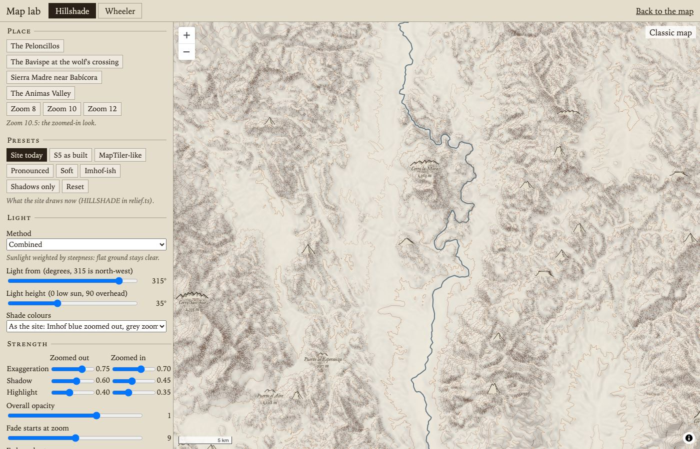
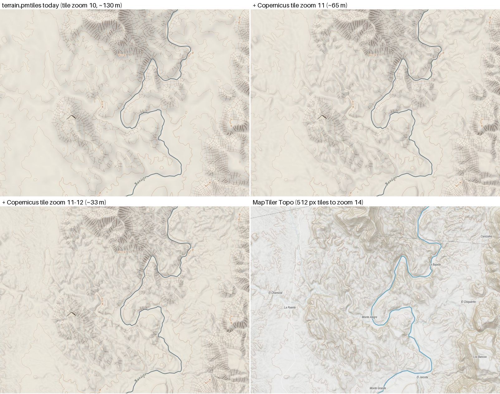
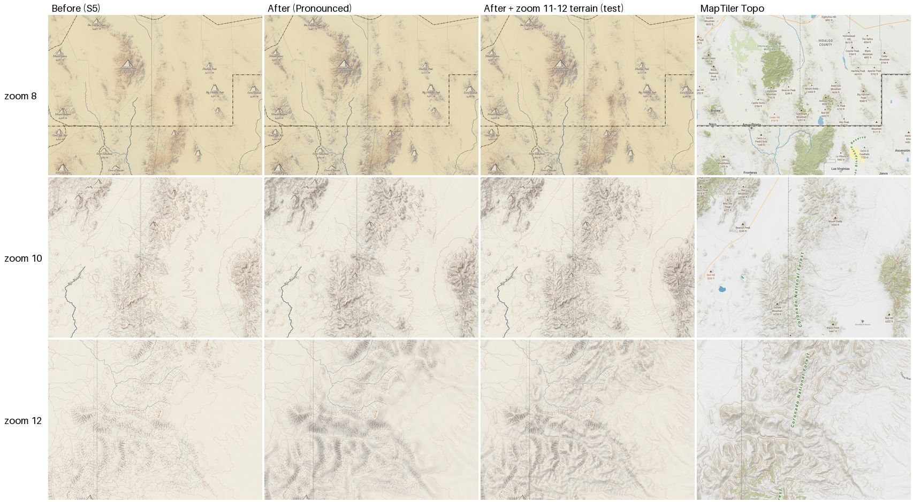
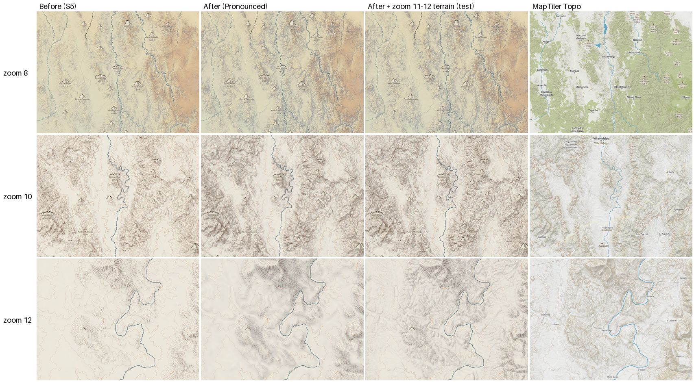
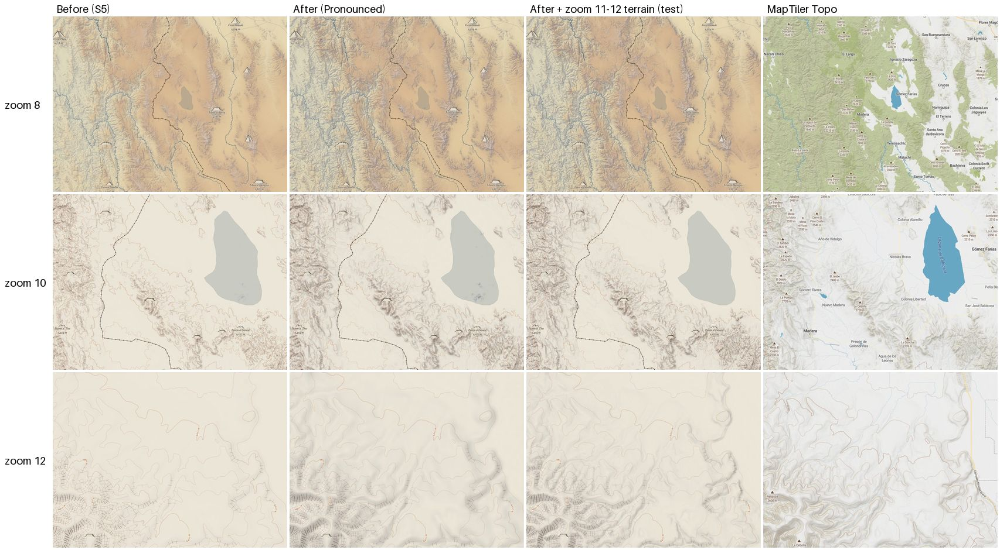
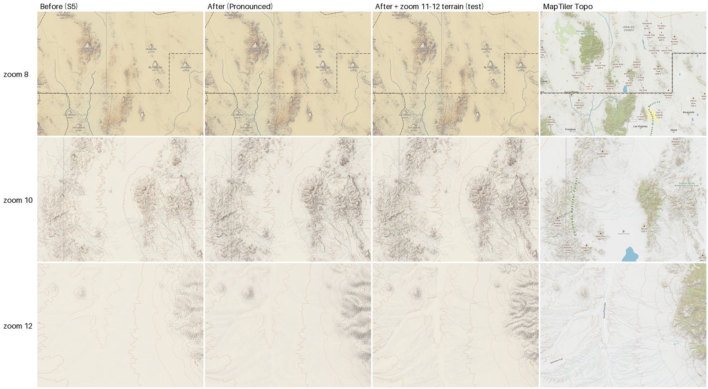
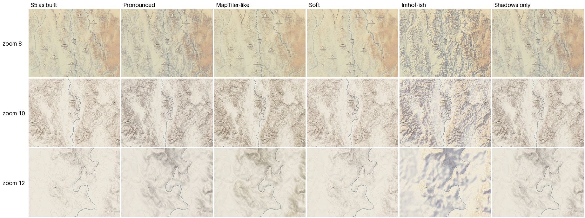

# Hillshade lab: a more pronounced hillshade, and why MapTiler Topo looks sharper

The owner asked for a more pronounced hillshade, "more like the MapTiler Topo", suspected MapTiler's resolution is higher, and asked for a lab page to tweak it. Short answers:

- **Yes, MapTiler's terrain is sharper from map zoom 10 on.** Ours stops at tile zoom 10 (about 130 m a pixel here); theirs goes on to tile zoom 14 at 512 px. At map zoom 10 ours is 2 times coarser, from zoom 11 about 4 times coarser in real detail.
- **It is also much stronger by design.** MapTiler draws opaque grey shadows; the site's S5 style drew a 22% grey above zoom 10, on purpose, so the story leads.
- **Done:** a lab page (`site/lab.html`), a stronger default ("Pronounced", separate last commit), and a builder for sharper terrain that has *not* been run for a release (it needs one; command and sizes below).

## How to test

```
cd site && npm run dev -- --port 5192
open http://localhost:5192/lab.html
```

The lab is dev-server only: `npm run build` keeps `index.html` as its only entry, so the page is not published. Adding it as a second Rollup input would be one line in `vite.config.ts`. But it would publish a tool page that uses MapTiler sessions, and the Wheeler section is not reviewed yet, so I left it out.

To try the sharper terrain locally (git-ignored, about 30 MB, 20 s):

```
uv run --project pipeline python tiles/build_terrain_hi.py --bbox -109.6 29.0 -107.6 31.9 --out site/public/tiles/terrain-hi.pmtiles
```

Then tick "Sharper terrain from zoom 10" in the lab. The box covers all four test places.



## The lab

`site/lab.html` → `site/src/lab/main.tsx` → `LabApp.tsx`, with two tabs (arrow keys move between them; the open tab is kept in the address, `#hillshade` or `#wheeler`).

**Hillshade** draws the real classic map: `LabMap` builds the style with the site's own `literaryStyle()` from the same tiles, filtered to the reader's progress as on the site. The controls:

- **Place**: the Peloncillos, the Bavispe at the wolf's crossing, the Sierra Madre near Babícora, the Animas Valley; zoom 8, 10 and 12; a line saying which side of the fade the zoom is on.
- **Presets**: Site today, S5 as built, MapTiler-like, Pronounced, Soft, Imhof-ish, Shadows only, and Reset. Each preset has a one-line note.
- **Light**: method (Standard, Basic, Combined, Igor, Several lights), light direction, light height (greyed out for the methods that ignore it), shade colours (as the site, Imhof at every zoom, grey at every zoom, MapTiler's).
- **Strength**: exaggeration, shadow and highlight, each for "zoomed out" (below the fade) and "zoomed in"; overall opacity; the zooms the fade starts and ends at; hachure opacity.
- **Compare**: MapTiler Topo beside the map (the site's own `SatelliteMap`, on the same camera), and the sharper test terrain if built.
- **Copy settings**: the JSON to paste over `HILLSHADE` in `site/src/map/relief.ts`. The lab's settings are exactly that type, so a paste is all a change takes.

**MapTiler Topo does not load on localhost.** The key answers 403 from `localhost:5192` (plan section 7 says localhost should be among its allowed origins; it is not now, or not on this port). The lab notices, says so in the Compare box and shows the classic map alone. The Topo images in this packet come from the published preview, where the key works.

**Wheeler** is the placeholder `site/src/lab/wheeler/WheelerLab.tsx` ("Wheeler study: coming from the research branch"); the research branch replaces it. A section is any default-exported component with no props. `LabMap` (`site/src/lab/LabMap.tsx`) documents its props in a comment: `styleOverrides` (gets a copy of the classic style, returns the style to draw; MapLibre applies only the difference), `initialView`, `mapRef`, `onLoad`, `onMove`, `label`, and `children` for react-maplibre overlays.

Phone layout (390 x 844): the maps stack above the controls, which scroll.

## How the classic hillshade is made (before this change)

| | The site (S5, decision 0016) | MapTiler Topo (topo-v4) |
|---|---|---|
| Elevation | `terrain.pmtiles`: AWS Terrain Tiles (Terrarium), repacked by `tiles/build_terrain.py` (decision 0011). Mixed sources: USGS 3DEP/NED on the US side, SRTM about 30 m in Sonora, INEGI near Casas Grandes | `terrain-rgb-v2`: MapTiler's own mosaic, "30 m/pixel" (their docs: 30 m globally, 5 m in some areas) |
| Tiles | 256 px, tile zoom 5-10, lossless WebP, 46 MB | 512 px ("scale 2"), tile zoom 0-14, WebP |
| Encoding | Terrarium | MapTiler Terrain RGB |
| Method | `combined` | `standard` (not set, so the default) |
| Light | 315° (north-west), height 45° (default) | 335° (default), viewport anchor |
| Exaggeration | 0.65 below the fade, 0.5 above | 0.3 at zoom 0 rising to 0.6 at zoom 22 (about 0.45 at zoom 10-12) |
| Colours | Below the fade: blue-violet shadow at 50%, warm highlight at 35%. Above: grey shadow at **22%**, white highlight at 30% | shadow `hsl(0, 0%, 50%)`, highlight `hsl(51, 12%, 83%)`, accent `hsl(51, 67%, 56%)`, all **opaque** |
| Under it | Imhof desert tint (`color-relief`, 90%) below the fade; near-white paper (`color-relief`, 70%) above | plain light ground; no colour relief |
| Over it | From zoom 10: 50 m contours at 45%, sepia hachures fading in from zoom 10 to 13 (70% of strokes below 12), mountain glyphs | contours from `contours-v2`, peak labels |
| Zoom fade | Tint, paper, exaggeration and colours all interpolate from zoom 9 to 10 | none |

Map zoom and tile zoom differ: 256 px tiles are sharp one map zoom below their own number. So `terrain.pmtiles` is sharp up to map zoom 9, and from there MapLibre stretches its last tiles:

| Map zoom | Screen pixel at 31° N | Site's elevation pixel | MapTiler's elevation pixel | Site coarser by |
|---|---|---|---|---|
| 8 | 262 m | 262 m | 262 m | same |
| 9 | 131 m | 131 m | 131 m | same |
| 10 | 65 m | 131 m | 65 m | 2 times |
| 11 | 33 m | 131 m | 33 m | 4 times |
| 12 | 16 m | 131 m | 16 m (30 m data) | 8 times in pixels, about 4 times in real detail |
| 13 | 8 m | 131 m | 8 m (30 m data) | about 4 times in real detail |

That is the soft, blobby shading at zoom 12 under crisp hachures. MapTiler's look also comes from its opaque mid-grey shadow on white, with no hachures or tint competing.



Top left: today's terrain. Top right: plus Copernicus at tile zoom 11. Bottom left: plus tile zoom 11-12. Bottom right: MapTiler Topo. All with the new default.

## The default change (last commit)

The "Pronounced" preset is now `HILLSHADE` in `relief.ts`: the same `combined` method, direction and S5 colours, a lower sun (35°), and stronger shade:

| | S5 | Pronounced |
|---|---|---|
| Light height | 45° | 35° |
| Exaggeration, below / above the fade | 0.65 / 0.5 | 0.75 / 0.7 |
| Shadow alpha, below / above | 0.5 / 0.22 | 0.6 / 0.45 |
| Highlight alpha, below / above | 0.35 / 0.3 | 0.4 / 0.35 |

It is a clear gain at zoom 10, where the ranges now read as forms and not just as hachure texture, and a small one at zoom 8. At zoom 12 it is stronger but still soft until the sharper terrain ships. "S5 as built" stays in the lab to compare.

A commit before it (`refactor`) moved the hillshade into one settings object in `relief.ts` with no visible change. The built style differs only in an explicit light height of 45°, which is MapLibre's default.

Each sheet below: zoom 8, 10, 12 down; before, after, after with the sharper test terrain, and MapTiler Topo across. Reading progress "not started".






The other presets, at the Bavispe:



## Sharper terrain: worth it, needs a tile release (not run)

`tiles/build_terrain_hi.py` builds Terrarium WebP tiles from the cached Copernicus GLO-30 tiles (`private/cache/dem/copernicus*/`, all 81 of the story box). Copernicus is 1 arc-second (about 26 m by 31 m here), so tile zoom 12 (33 m) holds all its detail, and zoom 13 would only interpolate. Heights are rounded to 1 m: the fraction of a metre is noise that lossless WebP cannot compress, and 1 m steps showed no terracing in the tests.

Sizes, measured by encoding every 25th tile (`--estimate 25`):

| Height step | Tile zoom 11 (3,172 tiles) | Tile zoom 12 (12,463 tiles) |
|---|---|---|
| 1 m (default) | about 76 MB | about 239 MB |
| 0.5 m | 107 MB | 358 MB |
| 0.25 m | 123-132 MB | 433-457 MB |

The journeys' core country (110-107° W, 29-32° N) at 1 m: 12 MB at zoom 11, 31 MB at zoom 12.

**Recommended now:** tile zoom 11 for the whole story box, one archive of about 76 MB, under the project's 100 MB cap:

```
uv run --project pipeline python tiles/build_terrain_hi.py --zooms 11 11
# writes tiles/out/terrain-hi.pmtiles; publish it with the next tiles release
```

Gain: the hillshade is sharp at map zoom 10 and 2 times sharper at 11-13 (65 m instead of 130 m; see the top right of the resolution image). The site then needs a second raster-dem source `terrain-hi` in `reliefSources()` and the `hillshade` layer split at map zoom 10 into one on `terrain` (maxzoom 10) and one on `terrain-hi` (minzoom 10), as the lab's `applySettings()` does. The new layer id must join `BASE_LAYERS` (style.ts) and `NOT_RAISED` (MapView.tsx). I did not make that change: MapView is being changed on another branch, and the archive does not exist in a release yet. The Copernicus credit is already on the Credits page for the hachures; the archive carries it as its attribution too.

**Full detail later:** tile zoom 11-12 for the whole box is about 315 MB, so at least four archives. MapLibre cannot fall back from one archive to another, so each would need its own source and layer, clipped by bounds, and the seams would need checking. Zoom 12 only in the core box would leave the hillshade blank outside it above map zoom 11. The gain over zoom 11 is clear at map zoom 12-13 (bottom left of the resolution image matches MapTiler's detail), so it is worth it if the size is acceptable.

## Files

- `site/lab.html`, `site/src/lab/` (LabApp, LabMap, `hillshade/`, `wheeler/WheelerLab.tsx` placeholder, `lab.css`)
- `site/src/map/relief.ts`: `HILLSHADE`, `HillshadeSettings`, `hillshadePaint()`; the new default
- `tiles/build_terrain_hi.py`: the sharper terrain builder (estimate, bbox and zoom options)
- `tools/hillshade-lab-shots.mjs`, `tools/hillshade-sheet.py`: the shots and sheets in this packet

## Open questions

1. Is "Pronounced" right for the site, or too strong next to the journeys? The lab makes it a two-minute change either way. Decision 0016 says S5 is "subtle, so the story leads"; this moves away from that a little above zoom 10. Should 0016 get an update line, or a new decision?
2. Build and release `terrain-hi.pmtiles` at tile zoom 11 (76 MB)? Then the site change described above.
3. Should localhost be added back to the MapTiler key's allowed origins, so the lab can show Topo beside the map?
4. Publish the lab (one line in `vite.config.ts`) or keep it dev-only?
